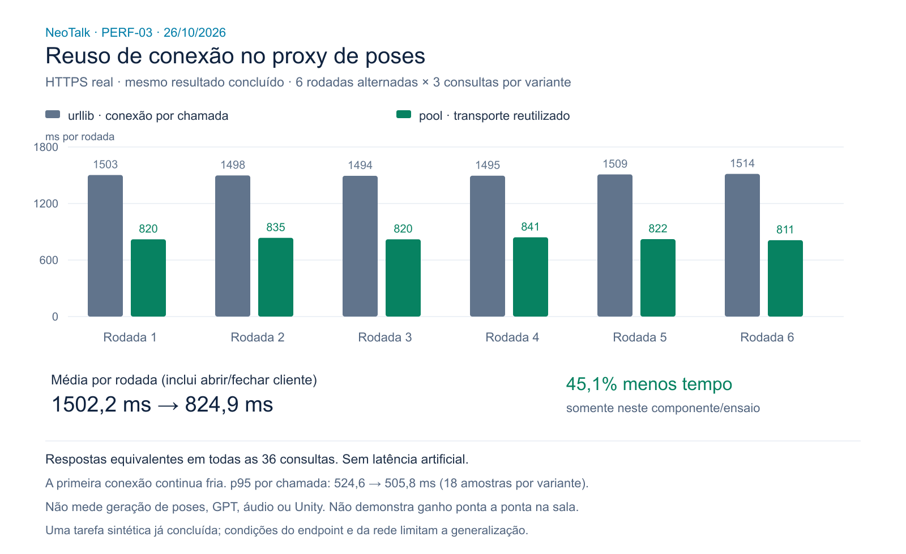

# PERF-03 — transporte HTTPS do proxy, 26/10/2026

**Ganho real do componente, não aprovação de fluidez da sala.** O pool anterior
era do backend da plataforma. O proxy Avatar3DFrontend ainda usava `urlopen`
para cada submit/status/download. Esta candidata reutiliza transporte HTTP no
lifespan do FastAPI, mantendo as consultas e os payloads reais.



## Comparação com endpoint real

Seis rodadas por variante, três consultas de status por rodada, ordem alternada
urllib/pool e pool/urllib. Uma tarefa sintética AMIGO foi criada e aguardada até
concluir; somente depois as duas variantes leram o **mesmo resultado concluído**.
36 consultas medidas, todas HTTP 200 e payloads JSON equivalentes por SHA-256.
Não são 36 gerações de pose. Não houve áudio, GPT ou sala de usuário no benchmark.

| Medida | urllib anterior | pool candidato | n por variante |
|---|---:|---:|---:|
| Média por rodada, incluindo criar/fechar cliente | 1.502,17 ms | 824,90 ms | 6 |
| Mediana da rodada | 1.497,91 ms | 820,07 ms | 6 |
| p95/máximo da rodada | 1.514,28 ms | 841,11 ms | 6 |
| Média da chamada, sem criar cliente | 500,68 ms | 272,89 ms | 18 |
| Mediana da chamada | 498,45 ms | 163,47 ms | 18 |
| p95/máximo da chamada | 524,58 ms | 505,82 ms | 18 |

Média da rodada caiu **45,09%** neste ensaio. A primeira chamada de cada rodada
do pool ainda abre conexão; p95 por chamada mudou pouco. Não extrapolar essa
porcentagem para tradução, geração, download, frame ou evento. Nenhuma latência
artificial foi adicionada. É comparação isolada de implementação do transporte
no host, não A/B de releases completos nem de infraestrutura de produção.

[Dados agregados sem credencial/URL/ID de tarefa](https-status.json) ·
[SVG](https-status.svg) ·
[Benchmark reproduzível](../../../tests/benchmark_neotalk_transport.py)

## Contrato, limites e segurança

- `httpx==0.28.1` passa da dependência de teste para runtime. Não ativa HTTP/2.
- Pool por processo: até oito conexões simultâneas, quatro ociosas, expiração
  de keep-alive de 30 s. Espera de pool até 5 s, demais timeouts preservados da
  configuração. Limite simultâneo não limita total de conexões na vida do app.
- Uma instância gerenciada por lifespan; encerramento/erro fecham o cliente.
  Chamadas diretas sem lifespan criam e fecham cliente temporário.
- Chave apenas por requisição à API, nunca no cliente compartilhado/download.
  Cookies do provedor não são armazenados/repassados. Nenhum cache de frase,
  transcrição, resultado GPT ou bytes de pose foi adicionado por este pool.
- JSON limitado a 1 MiB, arquivo ao limite configurado; leitura streaming
  termina no limite+1 e fecha resposta. Payload `.pose` original preservado.
- Redirect da API recusado para não encaminhar chave para outra origem.
  Download admite até cinco redirects e revalida HTTPS/ausência de credencial
  em cada destino; downgrade para HTTP é rejeitado. São restrições explícitas,
  não mudanças silenciosas para clientes que dependessem de redirect inseguro.
- Falhas mantêm `NeoTalkApiError`, status 502 e etapa submit/status/download;
  configuração ausente continua 503. Não há retry automático de POST no pool.
- Nenhum WebGL, solver, cena, `.pose`, mãos, duração, polling ou fila mudou.

## Testes e limites da evidência

32 testes Python passaram (16 existentes + 16 novos casos de transporte e
segurança), além de 28 testes Node do widget. Testes cobrem HTTP/1.1 real:
12 consultas/uma TCP, 40 chamadas concorrentes completas dentro do orçamento,
cookies descartados, autenticação isolada, corpo exato de submit, lifecycle,
erro/retomada, corpo grande/JSON inválido, timeout e redirecionamento seguro.
HTTPS de segurança/timeout usa transporte controlado, não certificado real.
O benchmark acima usa HTTPS real com verificação TLS normal.

O TestClient existente emite aviso de depreciação Starlette/httpx na suíte de
teste; não é falha funcional nem foi ocultado. Sem troca oportunista do SDK.

Integração do pacote Docker candidato concluída: dez frases diferentes/70
palavras, dez lotes completos **em cada saída**, Document PiP nativo/Edge
155.0.4283.62, GPT/NeoTalk/Unity reais. Primeiro e último frame e spans presentes
em todos; zero reset, pausa automática, erro, lote pulado ou rejeição. Duração
167,743 s. ASR pt-BR injetado e dispositivo de permissão falso, não voz física.

HTTP observado: dez traduções 200, dez submits 202, 39 polls 202 + dez polls
200 e 17 heartbeats 204. Intervalo PiP mediana 2,095 s/p95 4,058 s (n=9):
**fluidez ainda não aprovada**. Esses dez lotes não são comparação A/B dos 100
históricos, que tinham outra carga/cache/condição de memória.

Dados sanitizados da integração ficam na plataforma em
`docs/performance/2026-10-26/proxy-pool/integration.json`; brutos privados em
`outputs/real-services-1793034926657`. Imagem efetivamente executada do avatar:
`sha256:22fcb6786dd9fa657b862fc43dec5608018e1a65402d8631eb04e865981f3445`.
O benchmark host compara somente transporte; o rebuild Docker também resolveu
dependências transitivas. Não usá-lo para inferir ganho de release completa.

Rebuild final após o reforço de validação de URL passou em outro smoke de três
lotes, ambos os players completos, sem spans ausentes/pausa/reset/rejeição,
56,446 s. Imagem final:
`sha256:0d1428f3d8f2f516ff5184da7f1e5a952e3b2e84dd2a514eb23429c3899a3975`.
Relatório privado na plataforma: `outputs/real-services-1793035496945`.
Hashes do container correspondem ao checkout:
`app/neotalk.py` = `221082c1a2bce577ad2ffe89ee64722e5821d6e9e07c59ac966409c9a4653f5c`;
`app/main.py` = `8c97d1ebc7a9ce6385f1cdd8ee537b508b6d910ae19031057c3b95c3df2228ba`.

Não confundir callbacks nativos com inspeção visual integral. Continuam
pendentes preparação nativa PERF-02, estratificação/tamanhos/caches, microfone
físico e palestra prolongada. Sem merge/deploy de produção nesta subentrega.

## Reproduzir

Em ambiente autorizado, com env privado ignorado pelo Git (não colar chaves):

```powershell
python -m pytest tests -q
node --test tests/*.test.mjs tests/*.test.cjs
python tests/benchmark_neotalk_transport.py --env-file ../live-observability/.env.homolog.local --output outputs/transport-real.json
node scripts/render-transport-evidence.mjs docs/performance/2026-10-26/https-status.json
```

O benchmark cria uma única tarefa sintética e faz leituras limitadas; pode
consumir quota normal da API. Não executar automaticamente em CI.

Referência primária do mecanismo: [clientes HTTPX e pooling](https://www.python-httpx.org/advanced/clients/)
e [limites de recursos](https://www.python-httpx.org/advanced/resource-limits/).
